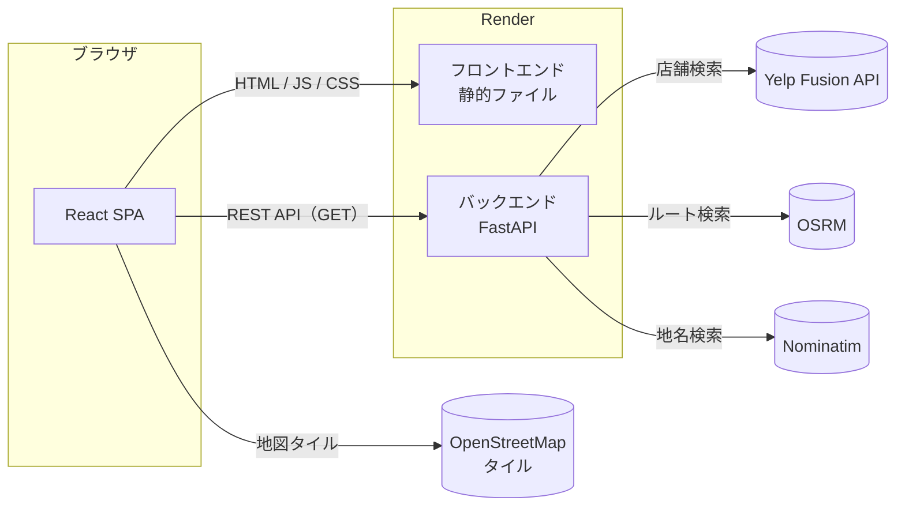
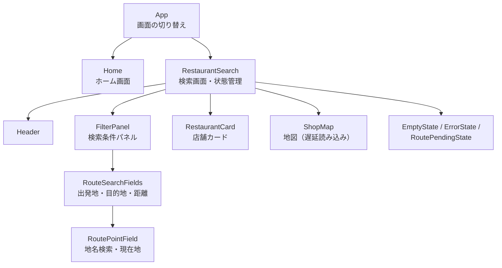
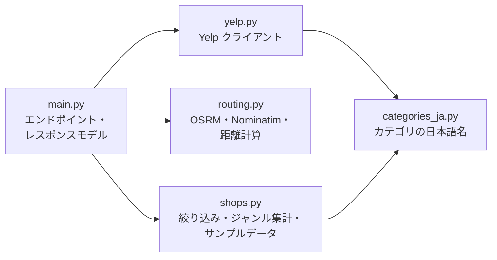
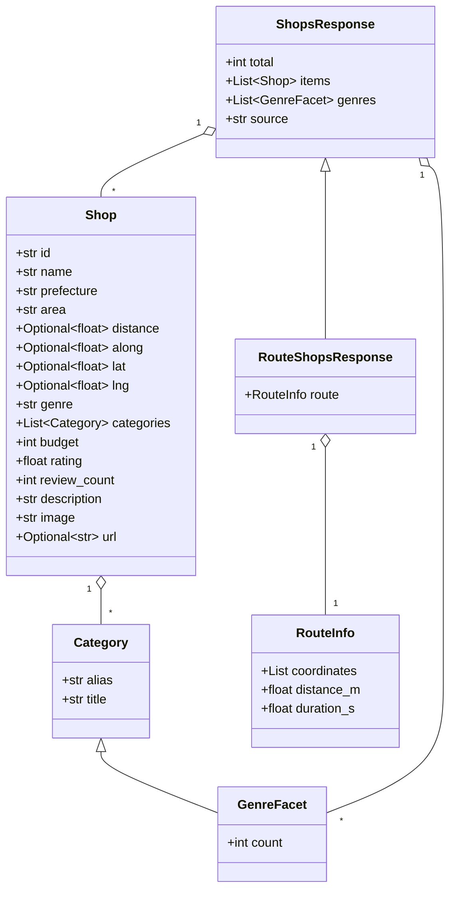
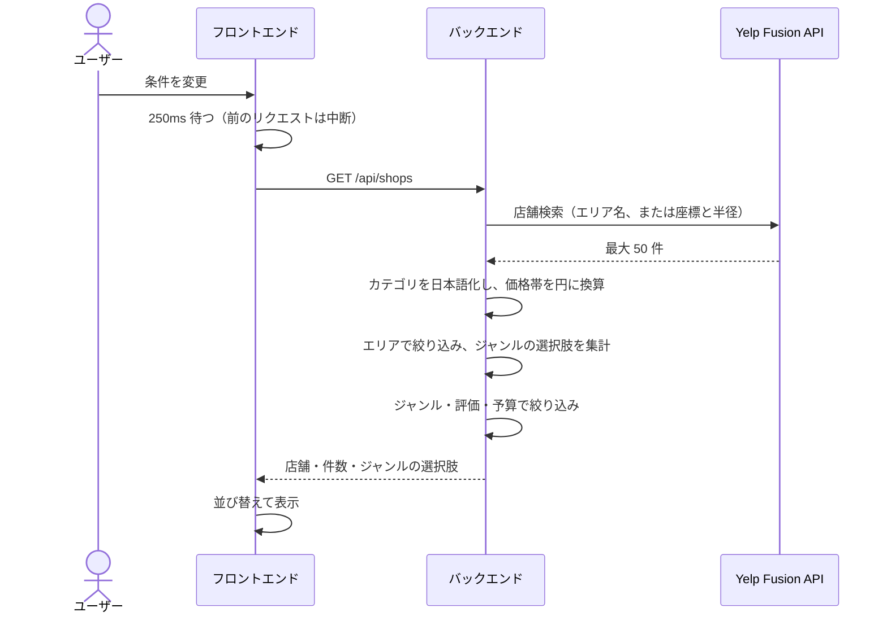
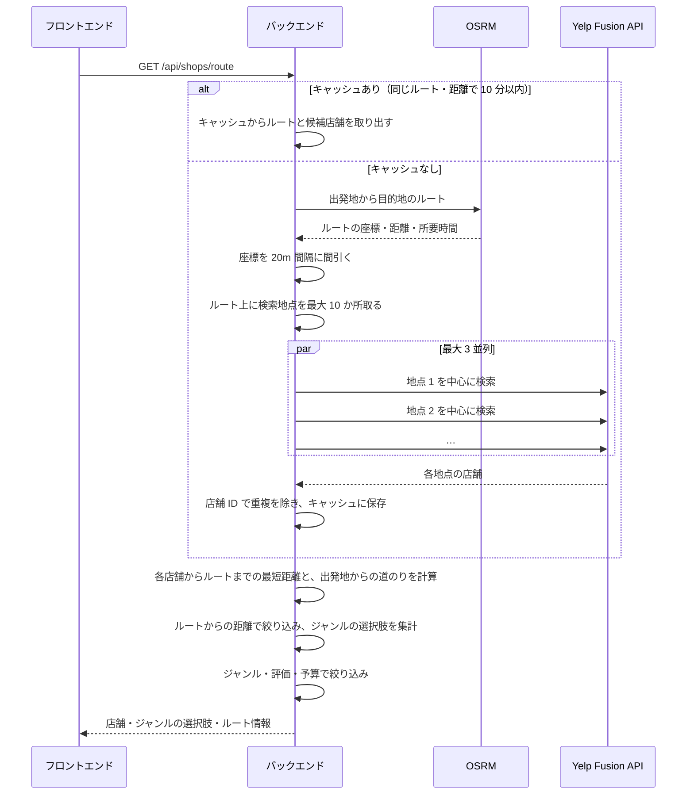
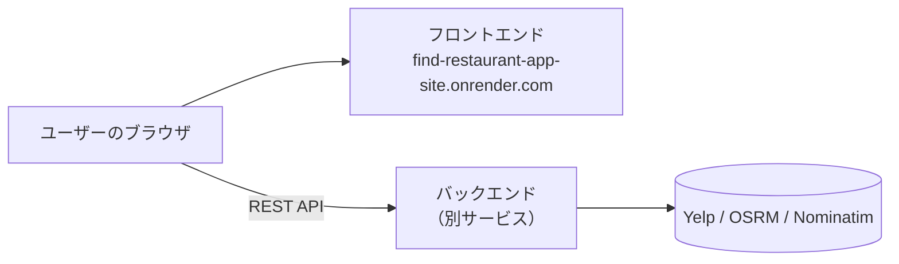

# FindRestr 設計書

> **要約**
> - React（SPA）と FastAPI（REST API）を分けた構成。外部 API（Yelp・OSRM・Nominatim）はすべてバックエンドから呼び、API キーをブラウザに渡さない。Render に別々のサービスとして公開している。
> - 中心となる設計は**ルート沿いの検索**。OSRM で求めたルート上の最大 10 地点で Yelp を並列に検索し、各店舗からルートまでの最短距離を計算して絞り込む。結果は 10 分間キャッシュする。
> - API の応答を固定の JSON に差し替え、実際のブラウザで操作する E2E テスト（pytest + Playwright、33 テスト）で画面の動作を検証している。

- 関連文書：[要件定義書](requirements.md)

---

## 1. システム構成

### 1.1 全体構成



- ブラウザが直接取得するのは地図タイルだけで、ほかの外部 API はすべてバックエンドを経由する。理由は次の 2 つ。
  - Yelp の API キーをブラウザに渡さないため。
  - Yelp Fusion API は CORS に対応しておらず、ブラウザから直接呼べないため。
- バックエンドはデータベースを持たない。店舗データは検索のたびに Yelp から取得し、ルート検索と地名検索の結果だけをメモリにキャッシュする。

### 1.2 技術スタックと選定理由

| 分類 | 技術 | 選定理由 |
| --- | --- | --- |
| フロントエンド | React 19 / TypeScript | UI の生成に使った Figma Make が React + Vite のプロジェクトを出力するため。型を付けることで、API のレスポンスの型（`Restaurant` など）をバックエンドのモデルとそろえられる |
| ビルド | Vite | 開発サーバーの起動とホットリロードが速い。生成されたプロジェクトの構成をそのまま使った |
| スタイル | Tailwind CSS v4 / shadcn/ui（Radix UI） | Select・Slider・Checkbox などのキーボード操作や読み上げに対応した部品を使い、自前で作る量を減らすため |
| 地図 | Leaflet + OpenStreetMap | API キーと課金の登録が不要で、無料で使える（Google Maps Platform は API キーと請求先の登録が必要）。ルート検索の OSRM と地名検索の Nominatim も OpenStreetMap のデータを使うため、地図とデータの出どころがそろう |
| バックエンド | Python 3.12 / FastAPI | ルート検索では複数の外部 API 呼び出しを並列に待つため、async に対応したフレームワークが向いている。Pydantic による入力値の検証と、API ドキュメント（Swagger UI）の自動生成も使える |
| HTTP クライアント | httpx（async） | FastAPI の async と組み合わせて、外部 API を並列に呼ぶため |
| 店舗データ | Yelp Fusion API | 無料で利用でき、ジャンル・座標に加えて**評価とレビュー数**を取得できる（評価での絞り込みとおすすめ順に必要） |
| ルート検索 | OSRM | API キーなしで使える。公開デモサーバーの代わりに、環境変数で自前のサーバーを指定することもできる |
| 地名検索 | Nominatim | API キーなしで使える。日本国内に限定し、日本語で結果を返せる |
| インフラ | Docker / Docker Compose / nginx | 本番相当・開発・E2E テストの 3 つの環境を同じ構成で起動できるようにするため |
| 公開 | Render | フロントエンドとバックエンドを別サービスとして公開している |
| テスト | pytest + Playwright | 実際のブラウザで画面を操作し、フロントが API に送る条件と画面の表示を検証するため |

### 1.3 開発の進め方（生成ツールの利用範囲と担当）

コードの生成には AI・デザインツールを使い、本人は要件の決定と AI への指示、外部 API の設定、Git での管理を担当した。

| 対象 | 担当 |
| --- | --- |
| 要件定義・AI への指示 | 本人 |
| 画面のデザイン | Figma、Uizard で生成 |
| フロントエンドのコード（画面・状態管理・API の呼び出し） | Figma Make で生成 |
| バックエンドの処理 | Claude Code で生成 |
| API の設定 | 本人 |
| Git による管理 | 本人 |

コミット履歴上の開発期間は 2026-10-20〜2026-11-04。

## 2. フロントエンド設計

### 2.1 コンポーネント構成



| ファイル | 役割 |
| --- | --- |
| `src/App.tsx` | URL のハッシュでホーム画面と検索画面を切り替える |
| `src/components/ShopSearch.tsx` | 検索条件と検索結果の状態を持ち、API を呼ぶ。条件パネル・カード・空表示も定義する |
| `src/components/RouteSearchFields.tsx` | ルート検索の入力欄 |
| `src/components/ShopMap.tsx` | Leaflet で店舗・現在地・ルートを描画する |
| `src/hooks/useGeolocation.ts` | 現在地の取得と、取得中・エラーの状態 |
| `src/data/restaurants.ts` | 型定義、検索条件の初期値、並び替え、API クライアント |
| `src/data/areas.ts` | 地方・都道府県・市区町村のデータ |

### 2.2 状態管理

状態管理ライブラリは使わず、検索画面のコンポーネント（`RestaurantSearch`）が `useState` で状態を持つ。子コンポーネントには props で値と変更用の関数を渡す。

| 状態 | 型 | 内容 |
| --- | --- | --- |
| `filters` | `SearchFilters` | 検索方法・エリア・現在地・ルート・予算・ジャンル・評価 |
| `sortKey` | `SortKey` | 並び順 |
| `view` | `"list" \| "map"` | 表示形式 |
| `shops` / `total` / `genreFacets` / `route` / `source` | — | API のレスポンス |
| `status` | `"loading" \| "ready" \| "error"` | 取得状態 |

**検索条件の変更から再取得まで**

1. `filters` が変わると `useEffect` が動く。
2. 250ms 待ってから `fetchShops` を呼ぶ（デバウンス）。その前に条件が変わったら、タイマーを取り消して待ち直す。
3. 新しい検索を始める前に、`AbortController` で前のリクエストを中断する。古いレスポンスがあとから届いて新しい結果を上書きすることを防ぐ。
4. 再取得中は前の結果を半透明で表示したままにし、画面がちらつかないようにする。

**並び替え**はフロントエンドで行う。並び順を変えるだけなら API を呼び直さない。

### 2.3 画面遷移

画面の数が 2 つだけなので、ルーティングライブラリは使わず、URL のハッシュ（`#main-menu`）と `hashchange` イベントで切り替える。ブラウザの戻るボタンにも対応する。

### 2.4 地図の遅延読み込み

Leaflet は `React.lazy` で、マップ表示に切り替えたときに初めて読み込む。リスト表示しか使わない場合は、地図のライブラリを読み込まない。

## 3. バックエンド設計

### 3.1 モジュール構成



`shops.py` と `routing.py` の計算部分は FastAPI に依存しない関数として分けてある。

### 3.2 API 仕様

すべて GET。パラメータが範囲外のときは、FastAPI の入力検証で 422 を返す。

#### `GET /api/shops`：エリア検索・現在地検索

| パラメータ | 型 | 範囲 | 内容 |
| --- | --- | --- | --- |
| `prefecture` | string | — | 都道府県（未指定なら東京都） |
| `area` | string | — | 市区町村（未指定なら都道府県全域） |
| `lat` / `lng` | float | ±90 / ±180 | 現在地。両方あれば `prefecture` / `area` より優先する |
| `radius` | int | 1000〜5000 | 現在地検索の半径（m）。既定 5000 |
| `genre` | string（複数可） | — | Yelp のカテゴリ alias（OR 条件） |
| `min_rating` / `max_rating` | float | 0〜5 | 評価の範囲 |
| `budget_min` / `budget_max` | int | 0 以上 | 予算の範囲（円） |

#### `GET /api/shops/route`：ルート検索

| パラメータ | 型 | 範囲 | 内容 |
| --- | --- | --- | --- |
| `olat` / `olng` | float | 必須 | 出発地 |
| `dlat` / `dlng` | float | 必須 | 目的地 |
| `buffer` | int | 100〜2000 | ルートからの距離（m）。既定 500 |
| `genre` / `min_rating` / `max_rating` / `budget_min` / `budget_max` | | | `/api/shops` と同じ |

#### `GET /api/geocode`：地名検索

| パラメータ | 型 | 範囲 | 内容 |
| --- | --- | --- | --- |
| `q` | string | 1〜200 文字 | 地名・住所・駅名 |

日本国内の候補を最大 5 件、`[{name, lat, lng}]` の形で返す。

#### `GET /api/health`：ヘルスチェック

`{"status": "ok", "source": "yelp" | "mock"}` を返す。Docker Compose の healthcheck で使う。

### 3.3 データモデル

フロントエンドの型（`src/data/restaurants.ts`）とバックエンドの Pydantic モデル（`backend/main.py`）は 1 対 1 で対応させている。



| 項目 | 内容 |
| --- | --- |
| `total` | 絞り込む前の件数（ルート検索ではルート周辺で取得した候補の数） |
| `distance` | 現在地検索では現在地から、ルート検索ではルートからの距離（m） |
| `along` | ルート検索のみ。出発地からルートに沿って測った距離（m）。ルート順の並び替えに使う |
| `budget` | Yelp の価格帯から換算した 1 人あたりの目安（円） |
| `source` | `yelp`（Yelp から取得）または `mock`（サンプルデータ） |

## 4. 主要な処理フロー

### 4.1 エリア検索・現在地検索



### 4.2 ルート検索



### 4.3 地名検索

1. ユーザーが地名を入力し、検索ボタンか Enter を押す。
2. フロントエンドが `GET /api/geocode?q=...` を呼ぶ。
3. バックエンドは、同じ検索語の結果がキャッシュにあればそれを返す。なければ Nominatim に問い合わせる（日本国内・日本語・最大 5 件）。
4. ユーザーが候補を選ぶと、その名称と座標を出発地（または目的地）にする。

## 5. アルゴリズム

### 5.1 ルートからの距離

各店舗について、ルート（折れ線）までの最短距離と、出発地からの道のりを求める。

1. 緯度・経度を平面座標（m）に変換する。ルート周辺の狭い範囲の計算なので、球面ではなく平面で近似する。経度方向は、ルートの平均緯度の cos で縮める。
2. ルートの区間（線分）ごとに、店舗の位置を線分へ射影し、線分上で最も近い点との距離を求める。
3. 全区間で最小の距離を「ルートからの距離」とする。その点までの道のりを「出発地からの道のり」とし、ルート順の並び替えに使う。

計算量は「店舗数 × 区間数」になる。区間数を減らすため、OSRM が返す座標は前の点から 20m 未満の点を間引いておく。検索幅は 100m 以上なので、20m の間引きによる精度への影響は小さい。

### 5.2 検索地点と検索半径の決め方

Yelp の検索は「中心と半径」で指定するため、ルート上に複数の中心を置いて、検索範囲の円がルート全体を覆うようにする。

```
半径 = max(ルートからの距離 × 2, 1500m)
間隔 = max(ルートの全長 ÷ 9, 半径)            … 地点数を最大 10 に抑える
半径 = min(40000m, max(半径, 間隔 × 0.75))     … 隣の円と重なるように広げる
```

- 隣り合う円が重なるよう、半径を間隔の 0.75 倍以上にしている。
- 40000m は Yelp の検索半径の上限。

### 5.3 おすすめスコア

```
おすすめスコア = 評価 × log10(レビュー数 + 10)
```

評価だけで並べると、レビューが 1 件で評価 5.0 の店が上位に来てしまう。レビュー数の対数を掛けることで、レビューが多い店を少し優遇する。レビューが 0 件でも、係数は 1 になる（log10(10) = 1）。

### 5.4 ジャンルの選択肢

1. 検索範囲（エリア・現在地周辺・ルート沿い）だけで絞り込んだ店舗のカテゴリを集計する。ジャンル・評価・予算で絞り込む前に集計するので、ジャンルを 1 つ選んでも、ほかのジャンルが選択肢から消えない。
2. 件数の多い順に並べ、件数が同じなら名前順にする。
3. フロントエンドでは、エリアを変えて選択肢から消えたジャンルでも、選択中であれば件数 0 として表示し続ける。そのために、これまでに見たジャンルの表示名を覚えておく。

## 6. エラー処理

| 発生箇所 | 状況 | HTTP ステータス | 画面の表示 |
| --- | --- | --- | --- |
| Yelp | 接続失敗・200 以外の応答 | 502 | エラーの理由と再読み込みボタン |
| OSRM | ルートが存在しない | 404 | 「ルートが見つかりませんでした」 |
| OSRM | 接続失敗・その他の失敗 | 502 | エラーの理由と再読み込みボタン |
| Nominatim | 接続失敗・200 以外の応答 | 502 | 入力欄の下にエラーの理由 |
| FastAPI | パラメータが範囲外 | 422 | 汎用のエラーメッセージ |
| ブラウザ | 位置情報の拒否・取得失敗 | — | 拒否か失敗かを区別したメッセージ |

- バックエンドはエラーの理由を日本語で `detail` に入れて返す。
- フロントエンドの API クライアントは `detail` が文字列ならそのまま画面に表示し、そうでなければ汎用のメッセージを表示する。
- フロントエンドが自分で中断したリクエスト（`AbortError`）は、エラーとして扱わない。

## 7. セキュリティ設計

| 脅威・リスク | 対策 |
| --- | --- |
| API キーの漏えい | キーはバックエンドの環境変数だけに置き、フロントエンドには含めない |
| ほかのサイトからの API 利用 | CORS で、公開先のフロントエンド（`FRONTEND_ORIGIN`）と localhost だけを許可する。メソッドは GET のみ |
| 想定外の入力 | 全パラメータの型と範囲を FastAPI（Pydantic）で検証する |
| XSS | 地図のポップアップは DOM を組み立て、店名などを `textContent` で入れる（`innerHTML` を使わない）。React の画面は標準でエスケープされる |
| 外部リンクからの参照元の漏えい | 外部リンクに `rel="noreferrer"` を付ける |
| 外部 API の過剰な呼び出し | ルート検索の Yelp 呼び出しは最大 10 地点・3 並列に抑える。ルートと地名の結果はキャッシュする |

## 8. インフラ・デプロイ

### 8.1 Docker 構成

| 構成 | コマンド | 内容 |
| --- | --- | --- |
| 本番相当 | `docker compose up --build` | フロントエンドをビルドし、nginx で配信する（:8080）。バックエンドは :8000 |
| 開発 | `docker-compose.dev.yml` を重ねる | Vite と uvicorn をホットリロードで起動し、ソースをマウントする |
| E2E テスト | `docker-compose.e2e.yml` を重ねる | Playwright 入りのコンテナを、フロントエンドとネットワークを共有して起動する |

- フロントエンドの `Dockerfile` はマルチステージビルドで、依存関係のインストール・開発用・ビルド・本番用（nginx）を 1 つのファイルにまとめている。
- nginx は、SPA のどの URL にも `index.html` を返す。ビルドで生成されるファイル（`/assets/`）は名前にハッシュが付くので、1 年間キャッシュさせる。
- フロントエンドは、バックエンドの healthcheck が成功してから起動する。

### 8.2 公開環境（Render）



- フロントエンドとバックエンドを別々のサービスとして公開している。
- フロントエンドのビルド時に、バックエンドの URL を `VITE_API_BASE` として埋め込む。
- バックエンドの `FRONTEND_ORIGIN` に `https://find-restaurant-app-site.onrender.com` を設定し、CORS で許可する。

### 8.3 環境変数

| 変数 | 設定先 | 内容 | 既定値 |
| --- | --- | --- | --- |
| `YELP_API_KEY` | バックエンド | Yelp Fusion API のキー | 未設定ならサンプルデータ |
| `FRONTEND_ORIGIN` | バックエンド | CORS で許可するフロントエンドの URL（カンマ区切りで複数可） | なし（localhost のみ許可） |
| `OSRM_URL` | バックエンド | OSRM サーバーの URL | 公開デモサーバー |
| `OSRM_PROFILE` | バックエンド | ルートの種類 | `driving` |
| `VITE_API_BASE` | フロントエンド（ビルド時） | ブラウザから見た API の URL | `http://localhost:8000` |

## 9. テスト設計

### 9.1 方針

- **対象**：フロントエンドの画面の動作。実際のブラウザ（Chromium）を Playwright で操作する。
- **API の差し替え**：フロントエンドが呼ぶ `/api/*` を Playwright で横取りし、固定の JSON を返す。Yelp・OSRM・Nominatim には接続しないので、API キーが不要で、外部サービスの状態に左右されない。地図タイルの取得も遮断する。
- **検証すること**
  - 画面の操作によって、フロントエンドが API に**正しい条件を送る**こと（クエリパラメータを検証する）
  - API の応答（正常・0 件・エラー）に応じて、**正しく表示する**こと
- **環境**：位置情報をテストするため、ブラウザの位置情報を固定値にして許可しておく。位置情報は安全なオリジンでしか使えないため、E2E のコンテナはフロントエンドとネットワークを共有し、`http://localhost` で開く。

### 9.2 テストの観点

| ファイル | テスト数 | 主な観点 |
| --- | --- | --- |
| `test_home.py` | 2 | ホーム画面と検索画面の行き来、URL ハッシュで検索画面を直接開く |
| `test_area_search.py` | 6 | 初期条件、都道府県・市区町村、都道府県を変えたら市区町村が戻る、現在地と半径、位置情報の拒否 |
| `test_filters.py` | 7 | ジャンルの選択肢・複数選択・もっと見る、選択中のジャンルが消えない、予算、評価、リセット |
| `test_results.py` | 8 | カードの表示、並び替え、ルート順はエリア検索で出ない、マップ表示、0 件、API エラーと再読み込み、データの取得元の表示 |
| `test_route_search.py` | 10 | 両地点がそろうまで検索しない、地名検索と見つからない場合、ルート検索、ルート順、現在地を出発地に、入れ替え、距離と絞り込み条件の送信、地点の解除、ルートが見つからない場合 |

テスト数はテスト関数の数。並び替えなどはパラメータを変えて複数回実行する。

## 10. 設計上の判断

### 10.1 ルート沿いの店舗をどう集めるか

**採用した方式**：ルート上の最大 10 地点を中心に Yelp を検索し、結果をまとめてから、ルートまでの距離で絞り込む（[5.1](#51-ルートからの距離)、[5.2](#52-検索地点と検索半径の決め方)）。

| 方式 | 問題点 |
| --- | --- |
| 出発地と目的地の中間点を中心に、広い半径で 1 回だけ検索する | Yelp は 1 回で最大 50 件しか返さないため、長いルートほどルートから遠い店が多くなり、ルート沿いの店が取りこぼされる |
| ルートの頂点ごとに検索する | ルートの頂点は数百〜数千あるため、API の呼び出し回数が多すぎる |

採用した方式は、検索する地点の数を上限 10 に固定し、地点の間隔と検索半径をルートの長さに応じて変える。これで、API の呼び出し回数に上限を設けつつ、ルート全体を検索範囲に含めている。

### 10.2 絞り込みをバックエンドで行う

ジャンル・予算・評価の絞り込みはバックエンドで行い、並び替えだけをフロントエンドで行う。

- ルート検索では、ルートまでの距離による絞り込みがバックエンドで必須になる。エリア検索も同じ処理（`filter_shops`）にそろえ、絞り込みのロジックを 1 か所にまとめた。
- ジャンルの選択肢は「絞り込み前の検索範囲」から作る必要がある（[5.4](#54-ジャンルの選択肢)）。バックエンドで、範囲での絞り込みと条件での絞り込みを 2 段階に分けて行い、その間で集計している。
- 並び替えは結果の件数が変わらず、すぐに反映したいので、フロントエンドで行う。

### 10.3 ルート検索の結果をキャッシュする

ルートと候補店舗を、出発地・目的地・距離をキーに 10 分間（最大 32 件）メモリに保存する。

- ジャンル・予算・評価を変えるたびに OSRM と Yelp（最大 10 回）を呼び直すと、応答が遅くなり、外部 API の利用制限にも近づくため。
- 座標は小数点以下 5 桁（約 1m）に丸めてキーにする。
- プロセス内のメモリに置くキャッシュなので、サーバーを再起動すると消え、複数のプロセスでは共有されない。データベースを持たない今の構成では、これで十分と判断した。

### 10.4 Yelp のカテゴリ名を日本語にする

Yelp は日本語のロケールを指定しても、カテゴリ名を英語で返す。日本語名を取得できる API（`/v3/categories`）は開発者向けのベータ版でしか使えない。そこで、約 160 件のカテゴリの対訳表（`categories_ja.py`）をバックエンドに持ち、対訳がないものは英語のまま表示する。

### 10.5 API キーがなくても動くようにする

`YELP_API_KEY` が未設定の場合は、東京の 16 店舗のサンプルデータを返す。API キーを持たない人でもアプリを起動して全機能を試せるようにするため。画面には、サンプルデータを表示中であることを表示する。
