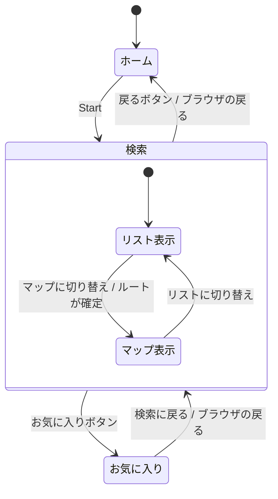

# FindRestr 要件定義書

> **要約**
> - 出発地から目的地までの**ルート沿いで寄れる飲食店**を探せる Web アプリ。エリア検索と現在地周辺の検索にも対応する。
> - 旅行中、ルート上で寄れる店を既存のグルメアプリや地図アプリでは探しにくかった体験から生まれた。想定ユーザーはドライブ中の人と、土地勘のない出張者。
> - 店舗データは Yelp Fusion API から取得し、ジャンル・予算・評価・設備（駐車場・大人数）で絞り込んで、リストと地図で表示する。気になった店はお気に入りに保存できる。

- 公開 URL：https://find-restaurant-app-site.onrender.com/
- 関連文書：[設計書](design.md)

---

## 1. 背景と目的

### 1.1 背景

旅行で目的地へ向かう途中に食事をしようとしたとき、既存の飲食店検索アプリや地図アプリでは「**このルートから外れずに寄れる店**」を探しにくかった。

- 飲食店検索アプリは「エリア」か「現在地周辺」で探す前提で、移動経路は考慮されない。
- 地図アプリでは経路の周辺を検索できるが、予算や評価などの条件で絞り込みにくい。

### 1.2 目的

**ルート沿いの飲食店を、予算・ジャンル・評価などの条件で絞り込んで探せる**ようにする。あわせて、普段使いのためにエリア検索と現在地周辺の検索も提供する。

## 2. 想定ユーザーと利用シーン

| ユーザー | 利用シーン | 主に使う機能 |
| --- | --- | --- |
| ドライブ中の人 | 旅行先へ車で向かう途中、ルートから 500m 以内で、駐車場があり評価 4.0 以上の店を探す | ルート検索、駐車場、評価、ルート順の並び替え、マップ表示 |
| 土地勘のない出張者 | 出張先の駅周辺で、同僚 4 人で入れる予算 3,000 円以内の夕食の店を探し、候補をお気に入りに残す | 現在地検索・エリア検索、大人数、予算、ジャンル、お気に入り |

## 3. スコープ

### 3.1 対象とする範囲

- 日本国内の飲食店の検索と閲覧
- 店舗の詳細情報は、Yelp の店舗ページへのリンクで提供する

### 3.2 対象外とする範囲

| 機能 | 扱い | 理由 |
| --- | --- | --- |
| ログイン・ユーザー登録 | 実装しない | 検索と閲覧だけのアプリで、ユーザーを識別する必要がないため（お気に入りはブラウザに保存する） |
| 予約 | 実装しない | 対象外とした |
| 口コミの投稿 | 実装しない | 対象外とした（評価とレビュー数は Yelp の値を表示する） |

## 4. 機能要件

### 4.1 機能一覧

| ID | 分類 | 機能 | 概要 |
| --- | --- | --- | --- |
| FR-01 | 検索 | エリア検索 | 都道府県と市区町村（東京都は渋谷・新宿などの繁華街単位）を選んで検索する |
| FR-02 | 検索 | 現在地検索 | ブラウザの位置情報で現在地を取得し、半径 1〜5km 以内を検索する |
| FR-03 | 検索 | ルート検索 | 出発地から目的地までのルートを求め、ルートから指定距離以内の店を検索する |
| FR-04 | 検索 | 地名検索 | 駅名・住所・施設名から、ルートの出発地と目的地の候補を検索する |
| FR-05 | 絞り込み | ジャンル | 検索範囲内の店舗のジャンルから複数選択する（OR 条件） |
| FR-06 | 絞り込み | 予算 | 1 人あたりの予算を範囲で指定する |
| FR-07 | 絞り込み | 評価 | 評価を範囲で指定する |
| FR-08 | 表示 | リスト表示 | 店舗をカードで一覧表示する |
| FR-09 | 表示 | マップ表示 | 店舗・現在地・ルートを地図に表示する |
| FR-10 | 表示 | 並び替え | 一覧の並び順を変える |
| FR-11 | 操作 | 条件のリセット | 検索条件を初期状態に戻す |
| FR-12 | 絞り込み | 設備 | 駐車場あり・大人数（4人以上）OK の店に絞り込む |
| FR-13 | お気に入り | 登録・解除 | 店舗カードのボタンでお気に入りに登録・解除する |
| FR-14 | お気に入り | 一覧表示 | お気に入りに登録した店を一覧表示する |

### 4.2 検索（FR-01〜04）

| ID | 要件 |
| --- | --- |
| FR-01 | 全 47 都道府県から選べる。市区町村は都道府県ごとに主要な 2〜13 か所と「全域」から選ぶ。都道府県を変えたら市区町村は「全域」に戻す。初期値は東京都全域とする |
| FR-02 | 「現在地から探す」で位置情報を取得する。半径はスライダーで 1〜5km（1km 刻み）から選び、初期値は 5km とする。解除するとエリア検索に戻る。位置情報を許可されなかった場合や取得に失敗した場合は、理由を画面に表示する |
| FR-03 | 出発地と目的地の両方が決まったら検索する。ルートからの距離は 200m / 500m / 1km / 2km から選び、初期値は 500m とする。出発地には現在地も指定でき、出発地と目的地は入れ替えられる。検索結果では、ルートの総距離と車での所要時間を表示する |
| FR-04 | 検索ボタンか Enter で検索し、最大 5 件の候補から選ぶ。入力中に自動で候補を出すことはしない（Nominatim の利用規約に従うため）。見つからない場合はその旨を表示する |

### 4.3 絞り込み（FR-05〜07）

| ID | 要件 |
| --- | --- |
| FR-05 | 選択肢は、検索範囲内の店舗のジャンルを集計して作る（件数の多い順、日本語表記、件数も表示）。最初は 12 件だけ表示し、残りは「もっと見る」で表示する。エリアを変えて選択肢から消えたジャンルも、選択中であれば件数 0 で表示し続ける |
| FR-06 | ¥0〜¥20,000 の範囲を ¥500 刻みで指定する。上限を ¥20,000 にしたときは「¥20,000 以上」（上限なし）として扱う |
| FR-07 | 0.0〜5.0 の範囲を 0.5 刻みで指定する。0.0〜5.0 のときは「指定なし」と表示する |
| FR-12 | 「駐車場あり」「大人数（4人以上）OK」をチェックボックスで選ぶ。両方選んだ場合は両方を満たす店（AND 条件）に絞り込む。Yelp に設備の情報がない店は、条件に合うか分からないため表示しない。その旨を条件の下に表示する |

- 検索条件を変えたら、ボタンを押さなくても自動で結果を更新する。

### 4.4 表示（FR-08〜10）

| ID | 要件 |
| --- | --- |
| FR-08 | カードには写真・ジャンル・お気に入りボタン・店名・エリア・距離・平均予算・設備（駐車場あり・大人数OK と分かっているもの）・説明・評価・レビュー数・「Yelpで見る」リンクを表示する。写真がない店舗や写真を読み込めなかった店舗には代わりのアイコンを表示する |
| FR-09 | 店舗をマーカーで表示し、クリックすると店名・評価・ジャンル・予算・Yelp へのリンクを表示する。現在地検索では現在地と検索範囲の円を、ルート検索ではルートと出発地・目的地を表示する。表示範囲はすべての地点が収まるように自動で合わせる。出発地と目的地がそろったら自動でマップ表示に切り替える |
| FR-10 | おすすめ順（初期値）、評価の高い順、価格の安い順、価格の高い順、ルート順（ルート検索時のみ。出発地に近い順）から選ぶ。ルート検索ではルート順を初期値とする |

### 4.5 お気に入り（FR-13〜14）

| ID | 要件 |
| --- | --- |
| FR-13 | 店舗カードのハートのボタンで登録・解除する。登録した店はボタンを塗りつぶして表示する。ログインなしで使えるよう、お気に入りはブラウザに保存し、ページを再読み込みしたりブラウザを閉じたりしても残す。登録できるのは 50 件まで |
| FR-14 | ヘッダーの「お気に入り」ボタン（登録件数を表示）で一覧を開く。一覧は新しく登録した順に並べ、検索結果と同じカードで表示する。開くたびに最新の店舗情報を表示する。一覧からも解除でき、解除した店はすぐに一覧から消える。一覧から検索画面に戻ったときは、検索条件と結果をそのまま残す |

### 4.6 異常時の動作

| 状況 | 動作 |
| --- | --- |
| 条件に合う店が 0 件 | 条件をゆるめるよう案内し、条件をリセットするボタンを表示する |
| ルート検索で出発地・目的地が未入力 | 入力を促す案内を表示する（API は呼ばない） |
| ルートが見つからない | 「ルートが見つかりませんでした」と表示する |
| API のエラー・通信エラー | エラーの理由と「再読み込み」ボタンを表示する |
| 位置情報を拒否された・取得できない | 拒否か取得失敗かを区別してメッセージを表示する |
| 座標がない店舗 | 地図には出さず、その件数を地図の下に表示する |
| お気に入りが 0 件 | 登録方法を案内し、検索画面に戻るボタンを表示する |
| お気に入りの店の情報を取得できない（閉店など） | 取得できなかった件数を表示し、まとめてお気に入りから削除できるようにする |
| お気に入りの店の情報の取得でエラー | エラーの理由と「再読み込み」ボタンを表示する |
| お気に入りが 50 件に達した | 未登録の店のお気に入りボタンを押せなくする |

## 5. 画面要件

### 5.1 画面一覧と遷移

| 画面 | URL | 内容 |
| --- | --- | --- |
| ホーム | `/` | アプリ名・イラスト・「Start」ボタン |
| 検索 | `/#main-menu` | 検索条件パネルと検索結果（リスト / マップ） |
| お気に入り | `/#favorites` | お気に入りに登録した店の一覧 |

URL のハッシュで画面を切り替えるため、検索画面やお気に入りの一覧を直接開いたり、ブラウザの戻るボタンで前の画面に戻ったりできる。

### 5.2 レイアウト

| 画面幅 | 検索条件パネル |
| --- | --- |
| PC（1024px 以上） | 左に常に表示し、スクロールしても追従する |
| スマホ | 「絞り込み条件」ボタンで開閉する |

## 6. 非機能要件

### 6.1 性能・応答性

| 項目 | 要件 |
| --- | --- |
| 条件変更の反映 | スライダー操作中に何度も API を呼ばないよう、操作が 250ms 止まってから検索する |
| 古い結果の表示防止 | 新しい検索を始めたら古い検索のリクエストを取り消し、古い結果で上書きしない |
| ルート検索の再検索 | 同じルートでジャンル・予算・評価・設備だけを変えたときは、外部 API を呼び直さない |
| お気に入りの一覧 | 短時間に何度も開いても、同じ店の情報を外部 API から取得し直さない |
| 初期表示 | 地図のライブラリは、マップ表示に切り替えたときだけ読み込む |

### 6.2 セキュリティ

| 項目 | 要件 |
| --- | --- |
| API キーの保護 | Yelp の API キーはサーバーだけが持ち、ブラウザには渡さない |
| アクセス元の制限 | API を呼べるのは公開先のフロントエンドと、ローカル開発環境だけとする（CORS） |
| 入力値の検証 | API のパラメータは範囲を検証し、範囲外ならエラーにする |
| 外部データの表示 | 店名など外部から取得した文字列は HTML として解釈させない |

### 6.3 外部サービスの利用条件

| サービス | 守る条件 |
| --- | --- |
| Yelp Fusion API | 「Powered by Yelp」を表示する。店舗 ID 以外の Yelp のデータは 24 時間を超えて保存しない（お気に入りには店舗 ID だけを保存する） |
| Nominatim | 入力中の自動補完には使わず、アプリを識別できる User-Agent を送る |
| OSRM（公開デモサーバー） | 低頻度での利用に限る。商用利用はできない |
| OpenStreetMap | 地図に著作権表示をする |

### 6.4 可用性

- Yelp の API キーが未設定でも、サンプルデータ（東京の 16 店舗）で全機能を動かせる。

### 6.5 対応環境

| 項目 | 内容 |
| --- | --- |
| 動作確認済み | Chrome（Windows PC） |
| 画面幅 | PC とスマホの両方に対応する |
| 位置情報 | HTTPS か localhost で開いた場合にだけ使える（ブラウザの仕様） |

### 6.6 アクセシビリティ

- ボタン・スライダー・地図に読み上げ用のラベルを付ける。
- 検索件数の変化とエラーを読み上げソフトに通知する。

## 7. データについての制約

| 項目 | 制約 |
| --- | --- |
| 取得件数 | 1 回の検索で Yelp から取得するのは最大 50 件（ルート検索では最大 10 地点 × 50 件） |
| 予算 | Yelp は価格帯（$〜$$$$）しか返さないため、¥1,000 / ¥3,000 / ¥7,000 / ¥15,000 の目安に換算する |
| ジャンル名 | Yelp は日本語を指定してもカテゴリ名を英語で返すため、アプリ側の対訳表で日本語にする。対訳がないものは英語のまま表示する |
| ルート | 車での経路のみ |
| 駐車場 | Yelp の駐車場情報のうち、駐車場・立体駐車場・バレーパーキング・提携駐車場のいずれかがあれば「駐車場あり」とする（路上駐車は含めない） |
| 大人数 | Yelp の「グループ向け（Good for Groups）」属性で判定する。Yelp の属性には人数の定義がないため、4 人以上で入れるかの目安として扱う |
| 設備の情報量 | Yelp に設備が登録されている店は地域によって差がある（実測では新宿は 50 件中 37 件に駐車場の情報があったが、長野県松本市は 50 件中 4 件だった）。情報がない店は設備で絞り込むと表示されない |
| お気に入り | ブラウザごとに保存するため、別の端末やブラウザとは共有されない |

## 8. 今後の課題

| 課題 | 内容 |
| --- | --- |
| お気に入りの端末間での共有 | ログイン機能がないため、お気に入りは端末やブラウザをまたいで共有できない |
| 設備の情報が少ない地域 | 設備の情報は Yelp の登録状況に依存し、地方では情報がない店が多い |
